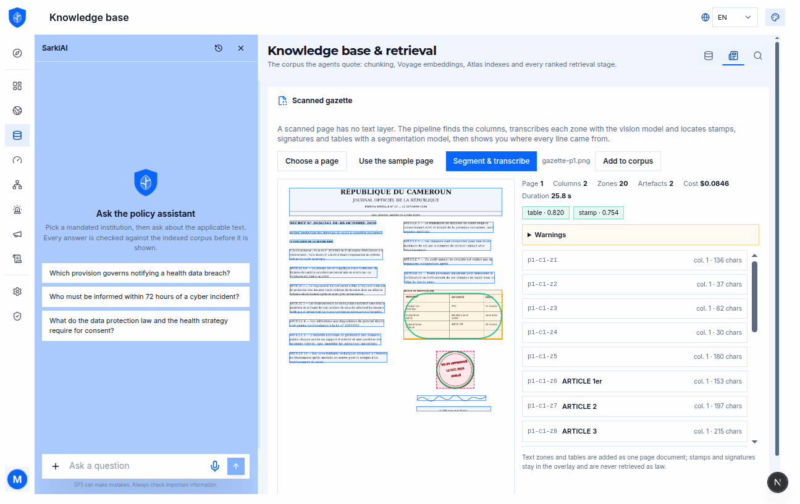
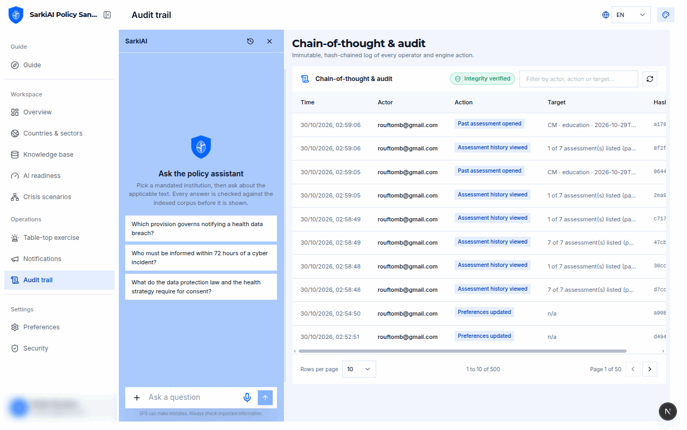
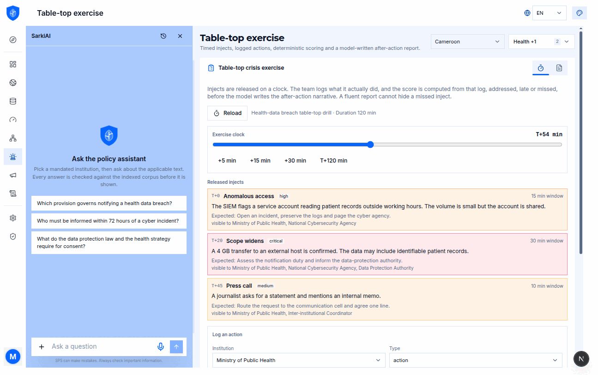
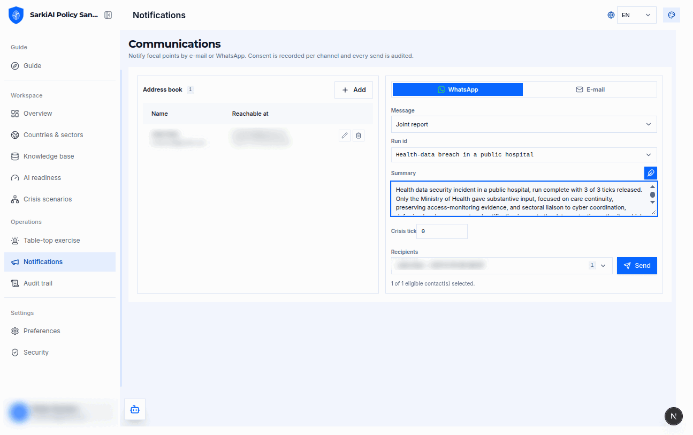

# SarkiAI Policy Sandbox

> Policy-grounded, multi-agent AI engine for the Meta Global AI Developer Hackathon (Startup track).
> One engine, two lenses: error-scenario simulation and AI-readiness assessment.

[](https://dev.meta.ai)
[](https://dev.meta.ai/models/muse-glimmer)
[](https://nextjs.org/)
[](https://fastify.dev/)
[](https://fastapi.tiangolo.com/)
[](https://docs.docker.com/compose/)

---

## Why

When a health-data incident hits a public hospital, responsibilities are split between the health
ministry, the data-protection authority, the telecom regulator and the cyber agency. Legal deadlines are
unclear, information arrives piece by piece, and decisions leave no trace.

This engine ingests a country's legal corpus and runs **mandated institutional agents** that must cite
the applicable provisions. A coordinator reconciles their assessments into a joint situation report and
flags conflicts between mandates. Every step lands in a **hash-chained audit log**.

It runs on **Meta models**, in three interchangeable provider modes:

- **cloud**: Meta Model API. Chat runs on the Muse Spark family (`muse-spark-1.1`, `muse-spark-1.2`,
  `muse-spark-1.3`) and `muse-wonder-1.0`, all listed by the key itself and selectable from the
  assistant's **+ menu**. The default is the newest `muse-spark-<version>` the key lists (`muse-spark-1.3`
  today); contributor builds are never the default. Also `sam-3.1` for scanned-gazette segmentation,
  `muse-voice-transcribe-1.0` for voice notes. Retrieval runs on **Voyage** embeddings and
  reranking over **MongoDB Atlas**: Meta publishes neither an embedding nor a reranking model, so
  `voyage-4` and `rerank-2` are the only non-Meta models in the pipeline. They produce no text and take
  no decision; every reasoning, vision, segmentation and speech step runs on Meta. See
  [Why Voyage](#why-voyage-for-retrieval).
- **sovereign**: **Muse Glimmer** (30B, Apache-2.0) served locally by Ollama: same engine, no data
  leaving the institution, retrieval stays on `bge-m3` + Qdrant.
- **local**: any Ollama-served model, **Muse Glimmer by default** (+ `bge-m3` embeddings), for offline
  development. On a machine without ~32 GB of VRAM, set `OLLAMA_MODEL` to a lighter model (e.g. `qwen3.5:9b`).

### Open weights: where they run and what they do

- **Muse Spark Open** (`meta-models/muse-spark-open-1026`) runs on **Baseten**. Pick it in the console's
  model menu (or set `SANDBOX_MODE=sovereign` with `BASETEN_API_KEY`) and it takes over **all reasoning**:
  mandated agents, coordinator, citation retries, impact analysis and exercise narrative. The audit chain
  records the model id of every step.
- **Muse Glimmer** (30B, Apache-2.0) runs on the institution's own hardware through Ollama (`make glimmer`)
  and is the default model of the `local` mode: same reasoning, nothing leaves the machine.
- SAM 3.1 and Muse Voice Transcribe stay on the Meta Model API in every mode.

What was built during the hackathon, with commits and times: [`HACKATHON.md`](HACKATHON.md).

Around the incident run, the sandbox also rehearses the team (**timed crisis
injects with a deterministic after-action score**) and can notify focal points
over **e-mail or WhatsApp**, with per-channel consent and an audited send.

- **Primary country:** Cameroon (MINPOSTEL-aligned), with a country/sector registry ready for more jurisdictions.
- **Primary domain:** healthcare, with cross-domain spillover (data protection, telecom, cybersecurity).
- **Open by design:** permissive license (Apache-2.0 code, CC BY 4.0 for project-authored content; third-party documents keep their own terms).

## Live demo

**<https://sps.djotta.com>**: the hosted console, in English and French, light and dark, running in `cloud` mode on the Meta Model API. Nothing is mocked: the corpus, the runs and the audit chain are live.

### First connection

The public deployment has two ways in: create your own operator account, or use the account handed out with the submission.

1. Open <https://sps.djotta.com>. A signed-out visitor lands on `/login`; the console forwards to `/setup` only when the operator store is empty, which is not the case on the demo.
2. **Own account:** open <https://sps.djotta.com/signup> (public sign-up is enabled on this deployment). Enter a first name, last name and a real address: the API mails a one-time password to it. If the mail cannot be delivered, the account is rolled back, so retry with another address.
   **Provided account:** sign in directly; the credentials come with the submission, never from this repository.
3. Replace the one-time password on the next screen (12 characters minimum, letters and digits), then scan the TOTP QR code with an authenticator app and store the ten recovery codes. They are shown once.
4. Every later sign-in asks for the password **and** the 6-digit TOTP code.
5. The workspace bar (country, domain, lens) is stored on the profile. For the announced demo, pick **Cameroon**, **health**, **simulation**.
6. The free API sleeps: the first call after a quiet period can take up to 40 seconds. Open the overview once and wait for the provider badge before starting a run. See [`docs/DEMO.md`](docs/DEMO.md) for the 3-minute recording plan.

### A look at the console

Screens built during the hackathon:

| Scanned gazette: columns, zones and per-zone transcription | Incident audit trail |
|---|---|
|  |  |

| Table-top crisis exercise | WhatsApp and e-mail notifications |
|---|---|
|  |  |

More screens (crisis-scenario graph, knowledge graph, countries registry, AI-readiness lens, guide, preferences, security) live in [`docs/screenshots/`](docs/screenshots): 1295-pixel-wide captures of the hosted app, palette-optimised with ImageMagick.

## One engine, two lenses, three profiles

| Lens | Purpose | Basis |
|------|---------|-----------|
| `simulation` | Run a progressive, chunked error scenario across mandated agents; produce an audit trail + gap findings. | scenario engine |
| `readiness` | Assess a country corpus against the 13 AI-readiness dimensions (6 factors); produce a gap report. | readiness framework |
| `hybrid` | Simulation that emits the readiness / gap report as a by-product. | both |

The two lenses are `simulation` and `readiness`; `hybrid` is the composition
profile. WhatsApp, voice notes, impact analysis, the table-top exercise and the
`/knowledge` console are capabilities of the same engine, not additional lenses.

The lens is a **declarative workflow profile** (`packages/shared`), never a duplicated code path.
Gap analysis is a **shared service** consumed by every lens, so no evaluation criterion is lost.

## Architecture

```
 data sources ──▶ collection ──▶ processing ──▶ retrieval & model ──▶ application ──▶ governance
      │               │              │                 │                   │              │
 data/country     services/      services/         packages/kb        packages/agents   packages/audit
 data/global      ingestion      ingestion+ocr     packages/retrieval packages/scenarios (audit + CoT)
                 (fetch/load)   (chunk+embed)                        packages/readiness
                                                                      packages/citations
```

See [`docs/PIPELINE-MAPPING.md`](docs/PIPELINE-MAPPING.md) for the file-by-file mapping.

## Repository layout

```
sarkiai-policy-sandbox/
├─ apps/
│  ├─ api/            # Fastify: agent orchestration, SSE streaming, REST/OpenAPI
│  └─ web/            # Next.js: lens selector, simulation console, readiness report
├─ packages/          # TypeScript workspace packages (@sps/*)
│  ├─ shared/         # types, workflow profiles, config, jurisdiction model
│  ├─ kb/             # ingestion client + knowledge-base domain logic
│  ├─ retrieval/      # RAG: Qdrant (bge-m3 + BM25, RRF) or Atlas + Voyage (cloud)
│  ├─ citations/      # article/section source attribution
│  ├─ gazette/        # scanned gazette: layout, SAM 3.1 artefacts, per-zone transcription
│  ├─ voice/          # voice notes: Muse Voice Transcribe / faster-whisper → timed facts
│  ├─ whatsapp/       # direct Meta Graph API client + signed approval tokens
│  ├─ impact/         # new policy → which open incidents change, and how
│  ├─ exercise/       # N8: timed injects, action log, deterministic after-action score
│  ├─ agents/         # roles, mandates, orchestrator (AI SDK ToolLoopAgent)
│  ├─ scenarios/      # progressive event engine (chunked release)
│  ├─ readiness/      # gap engine + AI readiness dimensions
│  ├─ audit/          # immutable audit log + persisted CoT traces
│  ├─ report/         # run dossier: audit + CoT + reports + citations
│  ├─ ui/             # shared components (SarkiAI Compact charter)
│  ├─ theme/          # admin theme packs (meta default, fada, green, ocean, sunset, mono)
│  └─ storage/        # MinIO/S3 client (content-addressed attachments)
├─ services/          # Python microservices
│  ├─ ingestion/      # structure-aware legal chunking + embeddings + Qdrant store
│  ├─ ocr/            # scanned gazette OCR (Tesseract)
│  └─ transcription/  # optional media → timestamped transcript
├─ data/              # corpora: country/cm, global/africa + global/standards (payloads git-ignored)
├─ deploy/
│  ├─ sandbox/        # locked-down sandbox deployment
│  ├─ mongo/          # Atlas Search indexes (kb.indexes.json) + local seed
│  ├─ ollama/         # Muse Glimmer Modelfile
│  └─ whatsapp/       # meta_hackathon_* template contract
└─ docs/              # strategic note, mapping, architecture, data model, roadmap
```

## Quick start

> **Pick a provider mode** with `SANDBOX_MODE` in `.env`: `local` (default,
> Ollama, no key, nothing leaves the machine), `sovereign` (Muse Glimmer on
> Ollama, or a hosted open-weight endpoint) or `cloud` (Meta Model API, requires
> `MODEL_API_KEY`). The badge in the console shows which one is answering.
> A first local run pulls Muse Glimmer (30B, see `docs/HARDWARE-REQUIREMENTS.md`) + ~1.2 GB (bge-m3).
> On a smaller machine, set `OLLAMA_MODEL=qwen3.5:9b` (~6.6 GB) before `make models`.

### Everything at once

```bash
cp .env.example .env
docker compose up --build -d
make models                # pull Muse Glimmer + bge-m3 into Ollama
```

Then:

- Web console (bilingual EN/FR, English by default) → http://localhost:3000
- API + OpenAPI → http://localhost:8000/docs
- Ingestion service → http://localhost:8001/docs
- OCR service → http://localhost:8002/docs
- Qdrant dashboard → http://localhost:6333/dashboard
- Ollama (local models) → http://localhost:11434
- MinIO console (attachments) → http://localhost:9001
- MongoDB (audit + CoT) → `mongodb://localhost:27017`

Recording the submission video? [`docs/DEMO.md`](docs/DEMO.md) is the 3-minute
runbook, pre-flight checks included.

### Origins, local and on-premise

A bare `docker compose up` needs no origin configuration. Link building falls
back to `http://localhost:3000`, local-network origins are always accepted
(loopback on any port, private IPs, container names, `.local`/`.internal`), and
the API keeps a permissive CORS policy until it is told otherwise.

For a host users reach from elsewhere, set the console's address:

```bash
WEB_PUBLIC_URL=https://<web-host>              # links sent by e-mail / WhatsApp
NEXT_PUBLIC_WEB_URL=https://<web-host>         # absolute metadata, build time
WEB_PUBLIC_URL_ALIASES=https://<other-host>    # optional, comma-separated
```

Once `WEB_PUBLIC_URL` is set, the API allowlist contains that origin, its
aliases, local-network origins and `*.vercel.app` previews. A *public* name that
differs from `WEB_PUBLIC_URL` (second domain, staging host) goes in
`WEB_PUBLIC_URL_ALIASES`; a LAN address or internal name never needs to.
`WEB_ALLOW_ANY_ORIGIN=true` is the escape hatch for a reverse proxy that cannot
be expressed as a list. Details in
[`deploy/api/README.md`](deploy/api/README.md) and
[`deploy/web/README.md`](deploy/web/README.md).

For a browser to reach the API from another machine, `NEXT_PUBLIC_API_URL` must
name the API as that machine sees it (`http://<host>:8000`), not `localhost`.


### Operator accounts (first run)

There is no seeded operator and no password in the source tree or in an
environment variable. The console knows one state: *is the operator store
empty?*

1. On the first visit, `/login` forwards to `/setup`. The screen asks for the
   root operator's first name, last name and e-mail.
2. The API creates the account with a **random one-time password** and mails it
   through [Resend](https://resend.com) (`POST /v1/auth/setup`). If the message
   cannot be delivered, the account is rolled back and the screen can be retried.
3. The first sign-in returns `password_change_required`: the console asks for a
   new password (12 characters minimum, letters and digits).
4. The same sign-in then continues into TOTP enrolment: QR code, 6-digit
   confirmation, ten single-use recovery codes shown once.

Setup requires three variables, shared with the enterprise stack:

```bash
AUTH_RESEND_KEY=re_...                       # Resend API key
AUTH_RESEND_EMAIL_FROM=SarkiAI Policy Sandbox <no-reply@your-domain>
AUTH_RESEND_EMAIL_REPLY_TO=you@your-domain
WEB_PUBLIC_URL=https://your-console.example   # used to build the sign-in link
WEB_PUBLIC_URL_ALIASES=https://your-project.vercel.app  # optional, comma-separated
```

Sessions are stateless HMAC tokens (7 days, `Authorization: Bearer`). Operators
live in MongoDB when it is reachable; otherwise the service keeps them in memory
so the console still authenticates, and `/setup` warns that the account will not
survive a restart. Password, enrolment and recovery-code writes fail loudly
(`storage_unavailable`) rather than pretending: a change that a restart would
forget is never reported as saved.

Every API route except the sign-in handshake, `/health`, the Meta webhook and
the signed approval links requires that Bearer token. Inside the console, the
operator's e-mail is the tenant key: audit records, chain-of-thought traces,
joint reports, scenario sessions, approvals and preferences are filtered by
`userId`, so two judges sharing the demo never see each other's runs. The legal
corpus and its vectors are deliberately shared: it is the same law.

### Forgotten password

`/login` → **Forgot password?** (`/forgot-password`) sends a signed, single-use
link to `/reset-password?token=…`. The link expires after **30 minutes**; a
completed reset invalidates every other pending link for that account and leaves
TOTP enrolled. The request endpoint answers `200` even for an unknown address, so
the console never reveals which e-mails are registered. It uses the same Resend
credentials as the invitation (`AUTH_RESEND_KEY`), and `WEB_PUBLIC_URL` builds the
link.

### Public sign-up (cloud demo only)

The public demo at <https://sps.djotta.com>
opens self-service accounts so judges can walk the console with their own login:
`/signup` shows what the sandbox does and the notice (prompts, answers and
files **may be used by Meta to train or improve its models**) in the left
column, then asks for a name, e-mail and password. The account is created and a
confirmation link is mailed (valid 24 hours). Until the address is confirmed,
sign-in stops at the confirmation step; only then does the operator reach the
mandatory TOTP enrolment, so no session exists before the second factor. A
sign-up in progress survives a reload: the auth pages show the progression
(password, e-mail, two-factor, access) instead of the forms. `AUTH_SIGNUP=true|false` overrides the default, which is *open in
cloud mode, closed otherwise*; `AUTH_MAX_OPERATORS` (default 12) caps the demo.
The **Create an account** link on `/login` stays visible once accounts exist , 
only the API gate closes self-service, not the presence of a root operator.

### Reset the demo state

Wipe the accounts and every operational collection while keeping the corpus:

```bash
bun run demo:reset -- --dry-run   # counts per collection, deletes nothing
bun run demo:reset -- --yes       # operators, password_resets, audit_logs,
                                  # cot_traces, joint_reports, whatsapp_approvals
```

It needs `MONGODB_URI` and never prints it. `kb_chunks`, the Atlas indexes and
all configuration are left untouched; the console then shows `/setup` again.

When the database is not reachable from your shell, run the same wipe from the
service itself: commit `apps/api/scripts/reset-on-boot.flag`, let the deploy
come live, then delete the flag and deploy again. The API logs
`demo reset executed at boot` with the total deleted.

### Switching provider

```bash
SANDBOX_MODE=cloud docker compose up -d api web      # Meta Model API
SANDBOX_MODE=sovereign docker compose up -d api web  # Muse Glimmer on Ollama
```

Cloud mode also needs `MODEL_API_KEY`, `VOYAGE_API_KEY` and a `mongodb+srv`
`MONGODB_URI`; the API creates the Atlas indexes at startup (see below). Local
and sovereign modes ignore those variables.

The switch is recorded in the audit chain as a `provider.switched` event, and
each chain-of-thought step names the mode and model that produced it.

#### Sovereign mode, step by step

Sovereign mode runs the same engine on **Muse Glimmer 30B** (dense, multimodal,
Apache-2.0) with no prompt, provision or answer leaving the institution.

```bash
ollama --version          # must be >= 0.32.7
make glimmer              # pulls muse-glimmer, builds the tuned sps-glimmer tag
```

Then in `.env`:

```bash
SANDBOX_MODE=sovereign
MUSE_GLIMMER_MODEL=sps-glimmer
bun run check:provider sovereign
```

`deploy/ollama/Modelfile.glimmer` only sets the model card's sampling
(1.0 / 0.95 / 64) and a 32K context: no system prompt, because the engine
already sends its own mandate and citation rules. On Apple silicon use
`muse-glimmer:30b-mlx` as the base tag.

Check a mode before a demo (one short answer, no secret printed, exits non-zero
on failure):

```bash
bun run check:provider            # SANDBOX_MODE
bun run check:provider cloud      # Meta Model API
bun run check:provider sovereign  # Muse Glimmer on Ollama
```

### Cloud retrieval (Voyage + MongoDB Atlas)

Local and sovereign modes keep the existing hybrid retrieval: `bge-m3` dense +
BM25 sparse in Qdrant, fused with RRF. Cloud mode uses the same `KbChunk`
contract on **MongoDB Atlas**:

1. ingestion chunks the document (headings, articles, sentence overlap), then
   embeds **Voyage `voyage-4`** (1024 dims, dotProduct);
2. `$vectorSearch` and `$search` (BM25, accent-folded analyser) run over
   `kb_chunks`;
3. the two lists are fused with RRF, then re-scored with **Voyage `rerank-2`**.

#### Why Voyage for retrieval

- **No Meta equivalent.** Meta publishes no embedding model and no reranking
  model, in the Meta Model API or as open weights. Retrieval needs both.
- **They rank, they do not answer.** `voyage-4` turns text into vectors and
  `rerank-2` orders candidate passages. Neither generates text, cites the law or
  takes a decision. What the agents say, the citations they choose, the conflicts
  the coordinator flags and every score are produced by Meta models.
- **The law is checked after retrieval, not trusted to it.** The citation
  validator compares every quote with the corpus: a poorly ranked passage can
  cost an answer, never fake one.
- **Why the reranker earns its place.** Legal questions match many near-identical
  articles (the same obligation repeated across laws and decrees). Dense + BM25
  fused with RRF finds them; the cross-encoder puts the applicable article first,
  so the agents read fewer, better passages and spend fewer Muse Spark tokens.
- **Swappable.** The corpus contract (`KbChunk`) is backend-neutral: `local` and
  `sovereign` run on `bge-m3` + Qdrant with RRF, and the same engine works without
  the reranker (it falls back to RRF if Voyage is unavailable). A Meta embedding
  model would replace Voyage without touching the agents.

`RETRIEVAL_BACKEND=auto` follows the provider mode (cloud → Atlas, otherwise
Qdrant). The index definitions live in code
([`packages/retrieval/src/atlas-index-definitions.ts`](packages/retrieval/src/atlas-index-definitions.ts)),
because the API image only ships `packages/` and `apps/api/`: a definition file
under `deploy/` would be missing in the container. They are created **only in
cloud mode**, at API startup: the collection first, then `sps_vector_index` and
`sps_text_index`, idempotently. [`deploy/mongo/kb.indexes.json`](deploy/mongo/kb.indexes.json)
stays as the artifact for the CLI, and a test fails if the two drift. To create
or repair them by hand (or from the console):

```bash
MONGODB_URI=... MONGODB_DB_NAME=policy_sandbox bun run kb:indexes
curl -X POST "$SPS_API_URL/v1/kb/indexes" -H 'Content-Type: application/json' -d '{}'
```

On the local Mongo used by Compose there is no Atlas Search; the script reports
`supported: false` and exits 0, and the engine stays on Qdrant.

#### The Knowledge base screen (`/knowledge`)

RAG is not a claim in this console, it is a screen. `/knowledge` shows the live
corpus and every step that produced it:

- **Corpus**: documents with chunk counts, characters, country, type and last
  ingestion; a document can be retired (chunks kept for audit, removed from
  retrieval) or restored.
- **Vectorise**: paste text or load `.txt` / `.md` / `.csv`, set country,
  jurisdiction, type, chunk size and overlap, then watch the six-step journal
  (accept → chunk → embed → upsert → index → verify) with per-step timings.
  Re-running the same document is a no-op: chunks are keyed by content hash.
- **Retrieval**: a playground that returns each stage separately (dense hits
  with `vectorSearchScore`, BM25 hits with their score, the RRF fusion, the
  reranked list and the final context), plus the Atlas filter, the timings and
  the model names.
- **Atlas indexes**: `READY` / `BUILDING` / missing, with a create-or-repair
  button that calls the same idempotent bootstrap as startup.

The API surface behind it:

| Route | Purpose |
|---|---|
| `GET /v1/kb/status` | totals, facets, index state, vector health, recent runs |
| `GET /v1/kb/documents` | per-document aggregates (`includeRetired` optional) |
| `POST /v1/kb/documents/active` | retire / restore one document |
| `POST /v1/kb/indexes` | create or repair the Atlas indexes |
| `POST /v1/kb/ingest/text` | chunk → embed → upsert → ensure indexes |
| `POST /v1/kb/search` | the playground: every stage, with scores |

Seed a corpus from the manifest (PDF text is extracted with `pdftotext`; scans
without a text layer are skipped and go through the Gazette screen):

```bash
SPS_API_URL=https://sps-api.example bun run kb:seed
bun run kb:seed -- --only snd30,psnsn --dry-run
```

Background and limits: [`docs/KNOWLEDGE-BASE.md`](docs/KNOWLEDGE-BASE.md).

### WhatsApp channel and approvals (N4)

The API talks to the **WhatsApp Cloud API directly** (`packages/whatsapp`,
~100 lines of `fetch`); no notification worker sits in between. Business-initiated
messages use approved utility templates prefixed `meta_hackathon_`:

| Template | Used for |
|---|---|
| `meta_hackathon_joint_report` | a joint situation report at a scenario tick |
| `meta_hackathon_deadline_alert` | an approaching legal deadline |
| `meta_hackathon_approval_request` | a decision that needs a human |
| `meta_hackathon_hello_world` | channel smoke test, no variable (the only one already approved) |

The approval message carries a **signed, expiring link** to the web app
(`/approve/:token`); there is no quick-reply. The operator reads the run, writes
an optional note, approves or rejects, and the decision is stored once in
`whatsapp_approvals` (`_id` = token `jti`) and appended to the audit chain as
`whatsapp.approval`. The webhook verifies `X-Hub-Signature-256` against the exact
raw body; inbound free text is acknowledged, never treated as an approval.

Template wording, categories and button configuration:
[`deploy/whatsapp/templates.md`](deploy/whatsapp/templates.md). Without a live
number, `POST /v1/whatsapp/notify` with `dryRun: true` returns the exact payload
and the signed link, which is what the demo uses.

### Operator notifications: e-mail and WhatsApp (N4b)

The Communications page notifies the people who must act. One shared address book
stores each contact with a consent flag **per channel**; the console only offers
recipients who consented, and the API re-checks the flag before sending. E-mail
goes out through a React Email template (`packages/notifications`), WhatsApp
through an approved template. Numbers are validated with `libphonenumber-js`
and stored in E.164 only. Every add, removal and successful send is appended to
the audit chain with the address masked.

The Meta status webhook is deliberately left unwired in this deployment (the
shared Meta app already routes its callback elsewhere): sending works, receipts
do not. Consent in real use would come from a public portal rather than an
operator's checkbox. Both decisions, the endpoints and the intended portal flow
are documented in [`docs/NOTIFICATIONS.md`](docs/NOTIFICATIONS.md).


### Scanned gazettes (N3)

Official journals are often published as scans with no text layer. The console's
**Scanned gazette** panel (or `POST /v1/gazette/analyze`) does four things:

1. binarises the page (Otsu) and finds the columns from ink projection profiles;
2. cuts each column into paragraphs / headings / tables in reading order;
3. transcribes one crop per zone with the vision model, and lets **SAM 3.1**
   locate stamps, signatures and tables (cloud mode only: in `sovereign` and
   `local` the geometric overlay still works);
4. tags every zone with page, column, bounding box, page sha256 and a deep link,
   then `POST /v1/gazette/ingest` writes the page into the jurisdiction-scoped
   knowledge base. Stamps and signatures stay in the overlay and are never
   retrieved as law.

Check the pipeline end to end on the synthetic demo page (a few cents at list
price, prints zones, artefacts, tokens and cost):

```bash
bun run check:gazette                                    # the sample page
bun run check:gazette path/to/scanned-page.png           # your own scan
```

### Voice notes (N6)

`POST /v1/voice/transcribe` takes a base64 RIFF/WAVE file (mono, 16-bit PCM,
16 kHz or 24 kHz: convert WhatsApp OGG/Opus first) and returns the transcript,
timed turns and `facts` (`T+00:12`, speaker label when diarization is on).
Cloud mode uses **Muse Voice Transcribe**; `sovereign` and `local` call the
on-premise `faster-whisper` service, so a recording never leaves the network.
The WAV header is checked before upload: a stereo or 44.1 kHz file is rejected
with the exact conversion to run, not transcribed badly.

### Legislative impact (N7)

`POST /v1/impact/analyze` takes a new provision and a list of open run ids. Runs
are filtered deterministically first (same article, same instrument), then the
model ranks the candidates and says what to re-run: a finding that names an
unknown run is dropped, so the analysis cannot invent a case. Deadline changes
and unaffected runs are returned alongside the findings, and the pass is recorded
as `impact.analyzed` in the audit chain.

### Crisis exercise (N8)

A scenario replays an incident; an exercise adds a clock and a team. The console's
**Table-top crisis exercise** panel loads a drill whose injects are released at
fixed minutes (`GET /v1/exercise/sample`). Participants log what they actually
did: action, decision, escalation or note: and `POST /v1/exercise/evaluate`
scores the log without calling a model: it separates addressed, late and
unanswered injects, computes coverage and average response time, and lists the
gaps.

`POST /v1/exercise/after-action` then asks the model to draft the narrative from
those already-computed facts. The narrative cannot change the score, so a
well-written report cannot hide a missed inject. The event is recorded in the
audit trail as `exercise.after_action`.

Optional local reranker (TEI, no cloud):

```bash
docker compose --profile rerank up -d      # then set RERANK_URL=http://rerank:80 in .env
```

### Individual services

```bash
docker compose up ollama qdrant ingestion ocr   # knowledge-base plane only
docker compose up api web                        # application plane only
docker compose up ollama qdrant ingestion        # just the KB ingest path
```

Or via the Makefile:

```bash
make up            # full stack
make models        # pull local LLM + embeddings
make up-kb         # ollama + qdrant + ingestion + ocr
make up-app        # api + web
make logs          # follow logs
make down          # stop
make clean         # stop + remove volumes
```

### Dev mode (hot reload + bind mounts)

```bash
docker compose -f docker-compose.yml -f docker-compose.dev.yml up
```

## Deployment

The public demo splits in two, because the two halves have different shapes:

| Piece | Host | Why |
|---|---|---|
| `apps/web` (Next.js) | a Next.js web host | static + one dynamic route (`/approve/[token]`) |
| `apps/api` (Fastify) | a Docker web service | long-lived process, SSE stream, WhatsApp webhook |

The API is deliberately not a serverless function: a serverless function cannot
hold the `/simulate` stream open or receive a webhook on a stable host. Exact
settings, environment variables and the warm-up strategy live in
[`deploy/web/README.md`](deploy/web/README.md) and
[`deploy/api/README.md`](deploy/api/README.md); the blueprint is
[`deploy/api/blueprint.yaml`](deploy/api/blueprint.yaml).

#### Model-call relay

If the API host's outbound traffic is refused by the Meta Model API (every call
returns `404 model_not_found`, on every model id, while the same key works from
the web host), point `META_BASE_URL` at the web app's relay:

```
META_BASE_URL=https://<web-host>/api/meta
MODEL_RELAY_KEY=<shared secret, same value as META_RELAY_KEY on the web host>
```

`apps/web/src/app/api/meta/[...path]` forwards the call to `api.meta.ai` with
the team key held in Vercel (`META_RELAY_MODEL_KEY`) and streams the answer
back. The route refuses any call without the `x-sps-relay-key` header and only
allows the `/v1` chat, responses, messages, models and embeddings paths. The
relay is transport only: no prompt, answer or key is logged.

WhatsApp needs three approved utility templates before any business-initiated
message is delivered: [`deploy/whatsapp/templates.md`](deploy/whatsapp/templates.md)
lists their exact bodies, ids and review status.

## Contributing

- Branch model and conventions: [`docs/RULES.md`](docs/RULES.md)
- Data model: [`docs/DATA-MODEL.md`](docs/DATA-MODEL.md)
- Roadmap: [`docs/ROADMAP.md`](docs/ROADMAP.md)

## License

- **Code**: Apache-2.0 (see [`LICENSE`](LICENSE)).
- **Project-authored content** (documentation, manifests, annotations, diagrams, own screenshots): CC BY 4.0 (see [`LICENSE-CONTENT`](LICENSE-CONTENT)).
- **Third-party source documents**: not covered by either licence and not redistributed. They keep their own terms; official texts are generally outside copyright, while reports, articles and research papers are used under their licence, by permission, or as short attributed quotations. Every manifest entry carries a `rights` status (`official-text`, `open-licence`, `quotation-only`, `to-confirm`).

See [`docs/LICENSING.md`](docs/LICENSING.md) for the rationale and provenance.

---

<div align="center">

Made with ♥️ by [Djotta](https://djotta.com)

</div>
